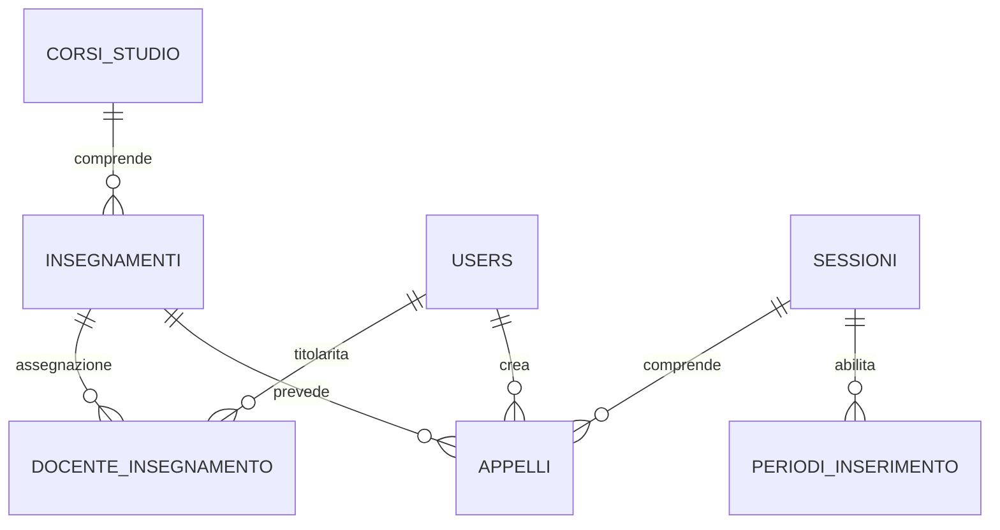

# Analisi del codice — Coordinamento Esami

Analisi iniziale del 9 novembre 2026. Aggiornamento del 24 novembre 2026.

Progetto esaminato `codice-interazione-persona-calcolatore`.

L’analisi descrive i file presenti nella copia di lavoro, inclusi quelli non ancora tracciati da Git. Le fonti principali sono rotte, controller, servizi, modelli, migrazioni, configurazioni, viste e test; il README è stato usato come riferimento iniziale e confrontato con l’implementazione. Lo schema descritto è quello definito dalle migrazioni: non è una rilevazione dei dati contenuti in un database di esercizio.

## 1. Scopo dell’applicazione e funzionalità

L’applicazione è un sistema web per il **coordinamento delle date degli esami universitari**. Centralizza la struttura didattica e permette ai docenti di pianificare gli appelli degli insegnamenti assegnati, verificando sovrapposizioni che coinvolgono gli studenti o le aule. Il nome mostrato nell’interfaccia è **Coordinamento Esami**.

Gli studenti sono beneficiari del coordinamento, ma non sono utenti modellati dal sistema: non esiste un ruolo studente, né sono presenti iscrizioni agli esami, verbalizzazione o gestione dei voti.

### 1.1 Architettura e tecnologie

Il progetto adotta l’architettura MVC di Laravel:

- **Backend:** PHP `^8.3`, Laravel `^13.0`, modelli Eloquent e database relazionale.
- **Pagine applicative.** Template Blade, Tailwind CSS 3.4 e componenti Blade in stile shadcn con tema Amber Minimal. Vite compila gli asset e jQuery invia le richieste AJAX per l’anteprima dei conflitti.
- **Autenticazione e profilo:** Laravel Jetstream, Fortify e Livewire.
- **Ruoli e permessi:** Spatie Laravel Permission.
- **Database predefinito:** SQLite; il progetto documenta anche la configurazione MySQL.

Le versioni indicate derivano dai requisiti del progetto, senza implicare una verifica di compatibilità con ogni versione ammessa.

Fonti: [composer.json](composer.json), [layout applicativo](resources/views/layouts/master.blade.php).

### 1.2 Funzioni principali

| Area | Funzioni implementate |
|---|---|
| Accesso pubblico | Landing page con logo a calendario e collegamento al login. Per chi ha già effettuato l’accesso, la homepage apre la dashboard. |
| Struttura didattica | Creazione, consultazione, modifica ed eliminazione di corsi di studio e insegnamenti; associazione di uno o più docenti agli insegnamenti. |
| Ricerca insegnamenti | Filtri per corso di studio, anno di frequenza e nome. |
| Sessioni d’esame | Gestione del nome e dell’intervallo di date della sessione. |
| Finestre di inserimento | Aggiunta ed eliminazione dei periodi nei quali i docenti possono pianificare gli appelli. Una sessione può avere più finestre. |
| Appelli | Creazione, elenco, modifica ed eliminazione; insegnamento, sessione, data, ora iniziale e finale, aula e note. |
| Controllo conflitti | Verifica durante la compilazione e al salvataggio; modalità di blocco oppure avviso configurabile. |
| Calendario | Consultazione degli appelli della sessione selezionata, raggruppati per giorno; segnalazione di conflitti e preappelli. |
| Dashboard | Dati e promemoria differenziati per ruolo, prossimi appelli e segnalazioni sugli insegnamenti ancora da pianificare. |
| Importazione CSV | Importazione amministrativa di corsi, insegnamenti e associazioni con docenti già esistenti; download di un file di esempio. |
| Account personale | Registrazione, accesso con opzione «Ricordami», uscita, recupero e modifica password, aggiornamento profilo, autenticazione a due fattori, chiusura delle altre sessioni e cancellazione account. |

La gestione delle finestre espone aggiunta ed eliminazione: non c’è una rotta dedicata alla loro modifica. Non è presente un pannello applicativo per amministrare utenti, ruoli o permessi.

Fonti: [rotte web](routes/web.php), [controller](app/Http/Controllers), [configurazione Fortify](config/fortify.php), [configurazione Jetstream](config/jetstream.php).

### 1.3 Regole di pianificazione

**Appelli.** Creazione, modifica e anteprima AJAX applicano gli stessi vincoli di pianificazione. La data deve essere odierna o futura, dal lunedì al venerdì, esclusi i giorni festivi. L’orario va dalle 08:00 alle 18:00, con fine successiva all’inizio. Il margine dei preappelli estende l’intervallo della sessione verso l’inizio di 14 giorni per impostazione predefinita, configurabili fra 0 e 60. I vincoli di data e orario valgono per entrambi i ruoli. L’applicazione respinge la riduzione del margine quando escluderebbe un preappello già pianificato. [Validazione degli appelli](app/Http/Controllers/AppelloController.php) · [Configurazione](app/Http/Controllers/ConfigurazioneController.php)

**Calendario civile.** Il giorno corrente per appelli, sessioni e scadenze segue `Europe/Rome`. I timestamp tecnici seguono il fuso UTC dell’applicazione. Il calendario delle festività include il Lunedì dell’Angelo e il 4 ottobre, festa nazionale di San Francesco d’Assisi dal 2026. [CalendarioEsami](app/Support/CalendarioEsami.php) · [CalendarioFestivita](app/Support/CalendarioFestivita.php) · [Legge 8 ottobre 2025, n. 151](https://www.gazzettaufficiale.it/eli/id/2025/10/10/25G00153/SG)

**Sessioni.** Alla creazione e alla modifica, l’inizio deve essere successivo al giorno corrente e la durata deve essere di almeno sette giorni, estremi inclusi. Il controllo si applica anche alle modifiche di sessioni già iniziate. La modifica delle date deve preservare gli appelli, compresi i preappelli, e la chiusura delle finestre già registrate.

**Finestre.** Possono aprirsi prima dell’inizio della sessione e devono chiudersi entro la sua data finale. Gli estremi sono inclusi nel controllo di apertura. Per i docenti, una modifica richiede una finestra aperta nella sessione di origine e in quella di destinazione. L’amministratore opera anche a finestre chiuse.

**Conflitti.** Due appelli confliggono quando coincidono la data e una porzione dell’orario e si verifica almeno una delle condizioni seguenti:

1. Gli insegnamenti appartengono allo stesso corso di studio e allo stesso anno di frequenza.
2. L’aula è la stessa, confrontando i nomi senza distinzione fra maiuscole e minuscole e rimuovendo gli spazi iniziali e finali.

Due intervalli adiacenti, ad esempio 09:00–11:00 e 11:00–13:00, sono compatibili. Il confronto uniforma gli orari salvati come `HH:MM` e `HH:MM:SS`, completando quelli al minuto con secondi pari a zero. Il confronto delle aule conserva gli spazi interni e considera solo i nomi compilati. Corso, anno e aula sono i criteri del motore conflitti.

Anteprima, salvataggio, dashboard, elenco e calendario considerano anche le sovrapposizioni con appelli di altre sessioni. Il calendario mostra le righe della sessione selezionata e segnala i conflitti su quelle righe. In modalità `blocco` il conflitto impedisce il salvataggio. In modalità `warning` l’appello viene salvato con una segnalazione.

Fonti: [validazione e vincoli degli appelli](app/Http/Controllers/AppelloController.php), [ConflittoService](app/Services/ConflittoService.php), [SessioneController](app/Http/Controllers/SessioneController.php), [PeriodoInserimentoController](app/Http/Controllers/PeriodoInserimentoController.php), [festività codificate](app/Support/CalendarioFestivita.php).

### 1.4 Monitoraggio e importazione

Il monitoraggio riguarda le sessioni ancora in corso o future e individua gli insegnamenti con **zero appelli** nella sessione. Le finestre sovrapposte o consecutive formano un periodo continuo. La scadenza coincide con il suo ultimo giorno di apertura, prima della prima interruzione. La finestra risulta in scadenza a sette giorni o meno dalla chiusura. La dashboard dell’amministratore segnala le finestre in scadenza o chiuse. Il docente vede i propri insegnamenti mancanti quando la finestra è aperta, in scadenza o chiusa. I promemoria sono mostrati nella dashboard.

Il CSV richiede `corso`, `insegnamento`, `anno_frequenza` e ammette `docenti`, contenente email separate da `|`. Sono accettati separatori virgola e punto e virgola. L’anno deve essere fra 1 e 3 e i docenti indicati devono già esistere con ruolo `docente`. L’applicazione valida le righe prima della transazione e riutilizza i corsi esistenti. Identifica gli insegnamenti per nome e corso, ne aggiorna l’anno e aggiunge le associazioni ai docenti. In modalità `blocco` annulla l’intera importazione se le modifiche generano nuovi conflitti fra appelli dello stesso corso e anno.

Fonti: [MonitoraggioService](app/Services/MonitoraggioService.php), [ImportController](app/Http/Controllers/ImportController.php).

## 2. Ruoli

Il seeder definisce due ruoli applicativi, entrambi associati a record della tabella `users`.

| Ruolo | Responsabilità |
|---|---|
| `amministratore` | Configura la struttura didattica, assegna i docenti agli insegnamenti, gestisce sessioni e finestre, importa la struttura, modifica le impostazioni e gestisce tutti gli appelli. |
| `docente` | Pianifica gli appelli degli insegnamenti di cui è attualmente titolare, anche in condivisione con altri docenti, e consulta il calendario con visibilità differenziata. |

Non esiste una tabella separata dei docenti. Il modello di Spatie ammette più ruoli per utente; nei controlli che distinguono amministratore e docente, il possesso del ruolo amministratore dà accesso alla vista amministrativa.

Un visitatore non autenticato non può consultare le pagine operative. Un utente registrato senza ruolo non costituisce un terzo ruolo: può accedere al proprio account e alla dashboard, che usa il ramo non amministrativo, ma le rotte di appelli e calendario richiedono espressamente `docente` o `amministratore`.

Fonte: [RolesAndPermissionsSeeder](database/seeders/RolesAndPermissionsSeeder.php), [rotte protette](routes/web.php), [DashboardController](app/Http/Controllers/DashboardController.php).

## 3. Permessi associati ai ruoli

### 3.1 Permessi registrati nel database

| Permesso | Amministratore | Docente |
|---|---|---|
| `appello_create` | Sì | Sì |
| `appello_edit` | Sì | Sì |
| `appello_delete` | Sì | Sì |
| `struttura_manage` | Sì | No |
| `config_manage` | Sì | No |

**Distinzione implementativa:** questi permessi sono creati e assegnati dal seeder, ma le rotte operative controllano i **ruoli**. La gestione del singolo appello aggiunge controlli sulla titolarità dell’insegnamento e sulle finestre. Nei percorsi applicativi esaminati non vengono interrogati direttamente i cinque permessi della tabella: modificarli da soli non ridefinisce i controlli di accesso attuali.

### 3.2 Operazioni e limiti effettivi

| Operazione | Amministratore | Docente |
|---|---|---|
| Gestire corsi e insegnamenti | Tutti | Non consentito |
| Assegnare o rimuovere titolari | Consentito tramite gestione insegnamenti | Non consentito |
| Gestire sessioni e finestre | Consentito | Non consentito |
| Importare CSV | Consentito | Non consentito |
| Modificare configurazione | Consentito | Non consentito |
| Creare appelli | Su qualunque insegnamento | Solo sugli insegnamenti assegnati e con finestra della sessione aperta |
| Modificare appelli | Tutti | Solo degli insegnamenti attualmente assegnati, con finestre aperte nella sessione di origine e in quella di destinazione |
| Eliminare appelli | Tutti, anche a finestra chiusa | Solo degli insegnamenti assegnati e con finestra della sessione corrente aperta |
| Consultare elenco appelli | Tutti | Solo degli insegnamenti attualmente assegnati |
| Consultare calendario | Tutti i dettagli previsti dalla vista | Dettagli degli insegnamenti assegnati e degli appelli di cui è autore, dati ridotti per gli altri |
| Verificare conflitti via AJAX | Su tutti gli insegnamenti e le sessioni | Sugli insegnamenti assegnati e con le stesse condizioni di apertura previste dal salvataggio |
| Gestire il proprio account | Consentito | Consentito |
| Amministrare account e ruoli altrui tramite pannello | Funzione non presente | Funzione non presente |

La titolarità segue la tabella `docente_insegnamento`, non `appelli.user_id`. Per esempio, se Anna e Luca sono titolari dello stesso insegnamento, Anna può gestire un appello creato da Luca. Se Anna viene rimossa dalla titolarità, perde l’accesso alla gestione anche degli appelli che aveva creato personalmente. Gli appelli restano nel database.

`appelli.user_id` registra chi ha creato l’appello, viene impostato dal server alla creazione e non viene sostituito durante la modifica. Può riferirsi anche a un amministratore: il nome della relazione Eloquent `docente()` non impone che l’autore abbia ruolo docente.

Fonti: [autorizzazione per titolarità](app/Http/Controllers/AppelloController.php), [selezione degli appelli del docente](app/Models/Appello.php), [assegnazione dell’autore](app/Http/Controllers/AppelloController.php), [test sulla co-titolarità e sulla rimozione](tests/Feature/AppelloTest.php).

### 3.3 Visibilità dei dati

Nel **calendario**, per gli appelli altrui il docente vede data, corso di studio, anno di frequenza e fascia oraria, con la dicitura «Occupato» al posto di insegnamento, autore e aula. La vista mostra anche i badge di conflitto e preappello. Per gli insegnamenti di cui è titolare, e per gli appelli di cui è autore, vede insegnamento, autore e aula. Le note non sono una colonna del calendario.

Nella **risposta AJAX sui conflitti**, il docente riceve anno, orario e motivi del conflitto. L’amministratore riceve anche nome dell’insegnamento, autore e aula. L’anteprima richiede `sessione_id` e restituisce HTTP 422 con i messaggi di validazione quando la richiesta viola i vincoli di pianificazione. Il form presenta quei messaggi nell’area dell’anteprima.

Fonti: [vista del calendario](resources/views/calendario/index.blade.php), [risposta della verifica conflitti](app/Http/Controllers/AppelloController.php).

## 4. Base di dati: struttura e relazioni

### 4.1 Persistenza

La configurazione predefinita usa SQLite nel file `database/database.sqlite`, con vincoli di chiave esterna abilitati salvo override di ambiente. `.env.example` imposta su database anche sessioni di accesso, cache e coda dei job. MySQL è un’alternativa documentata; il motore effettivamente usato da un’installazione dipende dall’ambiente.

Fonti: [config/database.php](config/database.php), [.env.example](.env.example).

### 4.2 Tabelle del dominio

Le tabelle seguenti hanno una chiave primaria `id` e i timestamp `created_at` e `updated_at`. `FK` indica una chiave esterna dichiarata nella migrazione.

| Tabella | Campi principali e vincoli | Significato |
|---|---|---|
| `users` | `name`, `email` univoca, `password`, `email_verified_at` facoltativo, `remember_token`; campi 2FA; `current_team_id` e `profile_photo_path` facoltativi | Account degli amministratori e dei docenti; il ruolo è memorizzato nelle tabelle Spatie. |
| `corsi_studio` | `nome` stringa | Corsi di studio. L’unicità del nome è validata nel controller, ma non c’è un indice univoco nella migrazione. |
| `insegnamenti` | `nome`, `anno_frequenza` intero senza segno, `corso_studio_id` FK obbligatoria | Ogni insegnamento appartiene a un corso. Il limite dell’anno a 1–3 è applicativo. |
| `docente_insegnamento` | `user_id` FK, `insegnamento_id` FK; coppia univoca | Tabella associativa delle titolarità; consente più docenti per insegnamento e più insegnamenti per docente. |
| `sessioni` | `nome`, `data_inizio`, `data_fine` | Periodi degli esami. Sono globali: non hanno una FK verso un corso di studio. |
| `periodi_inserimento` | `sessione_id` FK, `data_inizio`, `data_fine` | Finestre nelle quali il docente può operare sugli appelli di una sessione. |
| `appelli` | `insegnamento_id` FK, `sessione_id` FK, `user_id` FK, `data`, `ora_inizio`, `ora_fine`; `aula` stringa facoltativa, `note` testo facoltativo | Singoli appuntamenti d’esame e relativo autore. Tutte e tre le FK sono obbligatorie. |
| `configurazione` | `modalita_conflitto`: `blocco` o `warning`, default `blocco`; `giorni_preappello` intero senza segno, default 14 | Impostazioni globali. L’applicazione usa la prima riga, ma il database non impone che ne esista una sola. |

Le note sono limitate a 1.000 caratteri dalla validazione applicativa. L’aula è testo libero: non esiste una tabella `aule` con capienza, codice o disponibilità. I campi relativi a team e foto del profilo sono residui dello schema Jetstream: le relative funzionalità sono disabilitate nella configurazione.

Fonti: [migrazioni](database/migrations), [modelli Eloquent](app/Models).

### 4.3 Relazioni e cardinalità

| Relazione | Cardinalità | Collegamento |
|---|---|---|
| Corso di studio → insegnamenti | 1 : N | `insegnamenti.corso_studio_id` |
| Utenti/docenti ↔ insegnamenti | N : M | `docente_insegnamento` |
| Insegnamento → appelli | 1 : N | `appelli.insegnamento_id` |
| Sessione → appelli | 1 : N | `appelli.sessione_id` |
| Sessione → finestre | 1 : N | `periodi_inserimento.sessione_id` |
| Utente autore → appelli creati | 1 : N | `appelli.user_id` |

Sul lato N le FK sopra indicate sono obbligatorie. Un corso può avere zero insegnamenti; un insegnamento può avere zero titolari o zero appelli; una sessione può avere zero finestre o zero appelli. La relazione fra utente e insegnamento indica la titolarità attuale, mentre quella fra utente e appello indica l’autore.

`configurazione` è indipendente dalle altre entità. Il collegamento corso → appelli è derivato attraverso gli insegnamenti, esposto anche dalla relazione Eloquent `hasManyThrough`. Non esiste un’associazione diretta tra appello e finestra: l’apertura è verificata a partire dalla sessione e dalla data corrente. Non ci sono entità autonome per studenti, conflitti o preappelli: gli ultimi due sono calcolati dai dati esistenti.

### 4.4 Tabelle di ruoli e permessi

| Tabella | Struttura e funzione |
|---|---|
| `roles` | `id`, `name`, `guard_name`, timestamp; unicità di nome e guard. |
| `permissions` | `id`, `name`, `guard_name`, timestamp; unicità di nome e guard. |
| `model_has_roles` | `role_id`, `model_type`, `model_id`; associa i modelli, in questo progetto gli utenti, ai ruoli. |
| `role_has_permissions` | `permission_id`, `role_id`; associa i permessi ai ruoli. |
| `model_has_permissions` | `permission_id`, `model_type`, `model_id`; supporta permessi assegnati direttamente a un modello. Il seeder non ne assegna agli utenti. |

Utenti e ruoli, così come ruoli e permessi, sono in relazione N:M. I collegamenti ai modelli sono polimorfici: `model_id` è accompagnato da `model_type` e non costituisce una normale FK diretta verso `users`. La modalità team di Spatie è disabilitata.

Fonti: [migrazione delle autorizzazioni](database/migrations/2026_06_24_214309_create_permission_tables.php), [configurazione Spatie](config/permission.php), [seeder di ruoli e permessi](database/seeders/RolesAndPermissionsSeeder.php).

### 4.5 Tabelle tecniche

- `sessions`: sessioni di autenticazione, con identificativo, eventuale `user_id`, IP, user agent, payload e ultima attività. È distinta da `sessioni`, che contiene le sessioni d’esame. Il campo `sessions.user_id` è indicizzato, ma la migrazione non dichiara un vincolo FK.
- `password_reset_tokens`: email come chiave primaria, token e data di creazione.
- `personal_access_tokens`: token Sanctum, capacità, utilizzo e scadenza, con relazione polimorfica al titolare. Il pannello API Jetstream è disabilitato; è comunque definita la rotta autenticata `/api/user`. Non esiste un’API di dominio per amministrare corsi e appelli.
- `cache`, `cache_locks`: cache e lock applicativi.
- `jobs`, `job_batches`, `failed_jobs`: coda, gruppi di job e fallimenti.

Laravel mantiene inoltre la propria tabella `migrations` per tracciare le migrazioni applicate.

### 4.6 Cancellazioni e integrità

Le FK del dominio usano `cascadeOnDelete`:

| Eliminazione | Effetto |
|---|---|
| Corso di studio | Elimina insegnamenti, relativi appelli e associazioni ai docenti. |
| Insegnamento | Elimina appelli e associazioni ai docenti. |
| Sessione d’esame | Elimina appelli e finestre di inserimento collegate. |
| Utente | Elimina le sue associazioni di titolarità e tutti gli appelli dei quali risulta autore, anche se l’insegnamento ha altri titolari. |
| Singola associazione docente–insegnamento | Revoca la titolarità senza eliminare appelli o insegnamento. |
| Finestra di inserimento | Elimina solo la finestra; gli appelli restano. |

Le eliminazioni sono fisiche: nei modelli del dominio non è usato `SoftDeletes`. La cancellazione dell’account personale elimina anche i token tramite l’azione Jetstream; per gli appelli opera la cascata della FK all’autore.

Le regole su orari, date, durata delle sessioni, finestra aperta e conflitti sono implementate nei controller o servizi, non come vincoli relazionali del database. Non è definito un vincolo univoco che limiti un insegnamento a un solo appello per sessione.

Fonti: [migrazione degli appelli](database/migrations/2026_06_24_230005_create_appelli_table.php), [migrazione della titolarità](database/migrations/2026_06_24_230007_create_docente_insegnamento_table.php), [cancellazione account](app/Actions/Jetstream/DeleteUser.php).

## 5. Aspetti da considerare nella descrizione del sistema

1. **Registrazione senza assegnazione automatica del ruolo.** `CreateNewUser` crea l’account. Il seeder assegna i ruoli agli utenti dimostrativi e la gestione di ruoli e permessi avviene fuori dall’interfaccia. [CreateNewUser](app/Actions/Fortify/CreateNewUser.php) · [Seeder di ruoli e permessi](database/seeders/RolesAndPermissionsSeeder.php)
2. **Verifica email disabilitata.** Il modello `User` e la configurazione Fortify consentono l’accesso con l’indirizzo registrato senza un passaggio di verifica. [Configurazione Fortify](config/fortify.php) · [Modello User](app/Models/User.php)
3. **Visibilità del calendario per l’autore.** Un docente rimosso da un insegnamento perde la gestione dei relativi appelli. Nel calendario continua a vedere i dettagli degli appelli che ha creato personalmente. [Selezione degli appelli del docente](app/Models/Appello.php) · [Vista del calendario](resources/views/calendario/index.blade.php)

## 6. Code review e verifiche

La revisione del 24 novembre ha seguito l’anteprima AJAX, il salvataggio, lo spostamento fra sessioni, il calendario e il monitoraggio. Il servizio conflitti riusa l’insegnamento già caricato dal controller e il form usa l’area dell’anteprima per esporre gli errori restituiti dal server. È stato rimosso il listener JavaScript del vecchio evento di validazione, rimasto senza chiamanti. [Servizio conflitti](app/Services/ConflittoService.php) · [Form appelli](resources/views/appelli/_form.blade.php) · [Validazione frontend](resources/js/validation.js)

Il test esistente di spostamento ora usa una destinazione con finestra aperta. Per il docente verifica il rifiuto in anteprima e al salvataggio e controlla che l’appello conservi la sessione di origine. Per l’amministratore verifica il salvataggio nella destinazione. I casi già presenti verificano anche il cambio di giorno a mezzanotte italiana, la festività del 4 ottobre, i conflitti tra sessioni, le fasce orarie adiacenti e la scadenza di finestre contigue. [Test delle regole di pianificazione](tests/Feature/RegolePianificazioneTest.php)

La suite usa SQLite in memoria. I dati dimostrativi usati per la prova nel browser sono in un database SQLite temporaneo. [Configurazione PHPUnit](phpunit.xml) · [Suite di test](tests)

- `composer test` ha superato 223 test con 1.417 asserzioni, senza fallimenti o salti.
- `npm run build` e Pint sui file PHP oggetto della revisione sono riusciti. Il confronto dell’elenco delle rotte ha dato lo stesso risultato prima e dopo.
- In Playwright, una data fuori dalla sessione ha restituito HTTP 422 con il messaggio del server. Cambiando sessione, l’anteprima ha restituito HTTP 200 e ha sostituito l’avviso. Una fascia sovrapposta ha poi mostrato la segnalazione di conflitto. La console JavaScript non ha registrato errori durante il flusso.
