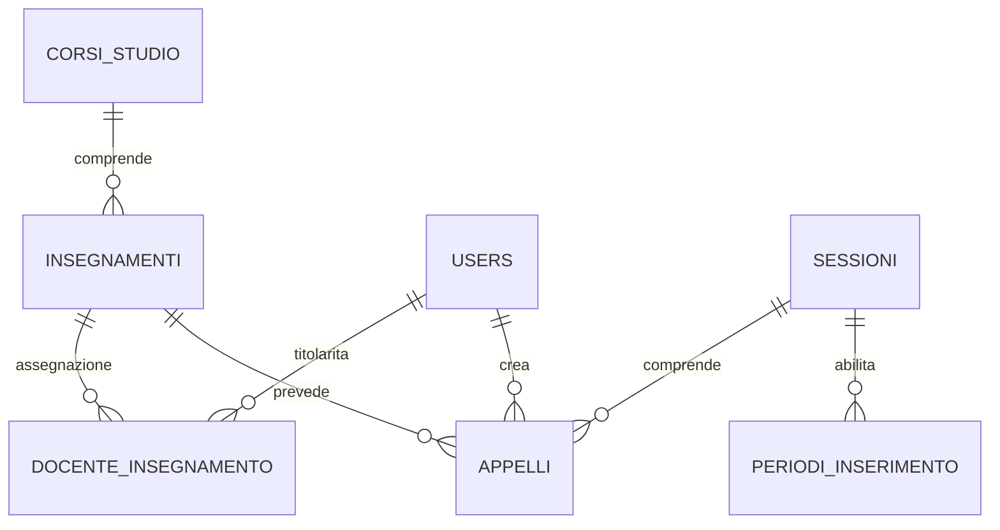

# Analisi del codice — Coordinamento Esami

Data dell’analisi: 9 novembre 2026.

Progetto esaminato: `/Users/mottyppo/Desktop/codice-interazione-persona-calcolatore`.

L’analisi descrive i file presenti nella copia di lavoro, inclusi quelli non ancora tracciati da Git. Le fonti principali sono rotte, controller, servizi, modelli, migrazioni, configurazioni, viste e test; il README è stato usato come riferimento iniziale e confrontato con l’implementazione. Lo schema descritto è quello definito dalle migrazioni: non è una rilevazione dei dati contenuti in un database di esercizio.

## 1. Scopo dell’applicazione e funzionalità

L’applicazione è un sistema web per il **coordinamento delle date degli esami universitari**. Centralizza la struttura didattica e permette ai docenti di pianificare gli appelli degli insegnamenti assegnati, verificando sovrapposizioni che coinvolgono gli studenti o le aule. Il nome mostrato nell’interfaccia è **Coordinamento Esami**.

Gli studenti sono beneficiari del coordinamento, ma non sono utenti modellati dal sistema: non esiste un ruolo studente, né sono presenti iscrizioni agli esami, verbalizzazione o gestione dei voti.

### 1.1 Architettura e tecnologie

Il progetto adotta l’architettura MVC di Laravel:

- **Backend:** PHP `^8.3`, Laravel `^13.0`, modelli Eloquent e database relazionale.
- **Pagine applicative:** template Blade, Bootstrap 5.3 e jQuery; la verifica preventiva dei conflitti usa AJAX.
- **Autenticazione e profilo:** Laravel Jetstream, Fortify e Livewire.
- **Ruoli e permessi:** Spatie Laravel Permission.
- **Database predefinito:** SQLite; il progetto documenta anche la configurazione MySQL.

Le versioni indicate derivano dai requisiti del progetto, senza implicare una verifica di compatibilità con ogni versione ammessa.

Fonti: [composer.json](/Users/mottyppo/Desktop/codice-interazione-persona-calcolatore/composer.json), [layout applicativo](/Users/mottyppo/Desktop/codice-interazione-persona-calcolatore/resources/views/layouts/master.blade.php).

### 1.2 Funzioni principali

| Area | Funzioni implementate |
|---|---|
| Struttura didattica | Creazione, consultazione, modifica ed eliminazione di corsi di studio e insegnamenti; associazione di uno o più docenti agli insegnamenti. |
| Ricerca insegnamenti | Filtri per corso di studio, anno di frequenza e nome. |
| Sessioni d’esame | Gestione del nome e dell’intervallo di date della sessione. |
| Finestre di inserimento | Aggiunta ed eliminazione dei periodi nei quali i docenti possono pianificare gli appelli. Una sessione può avere più finestre. |
| Appelli | Creazione, elenco, modifica ed eliminazione; insegnamento, sessione, data, ora iniziale e finale, aula e note. |
| Controllo conflitti | Verifica durante la compilazione e al salvataggio; modalità di blocco oppure avviso configurabile. |
| Calendario | Consultazione degli appelli della sessione selezionata, raggruppati per giorno; segnalazione di conflitti e preappelli. |
| Dashboard | Dati e promemoria differenziati per ruolo, prossimi appelli e segnalazioni sugli insegnamenti ancora da pianificare. |
| Importazione CSV | Importazione amministrativa di corsi, insegnamenti e associazioni con docenti già esistenti; download di un file di esempio. |
| Account personale | Registrazione, accesso e uscita, recupero e modifica password, aggiornamento profilo, autenticazione a due fattori, chiusura delle altre sessioni e cancellazione account. |

La gestione delle finestre espone aggiunta ed eliminazione: non c’è una rotta dedicata alla loro modifica. Non è presente un pannello applicativo per amministrare utenti, ruoli o permessi.

Fonti: [rotte web](/Users/mottyppo/Desktop/codice-interazione-persona-calcolatore/routes/web.php), [controller](/Users/mottyppo/Desktop/codice-interazione-persona-calcolatore/app/Http/Controllers), [configurazione Fortify](/Users/mottyppo/Desktop/codice-interazione-persona-calcolatore/config/fortify.php:146), [configurazione Jetstream](/Users/mottyppo/Desktop/codice-interazione-persona-calcolatore/config/jetstream.php:60).

### 1.3 Regole di pianificazione

**Appelli.** Alla creazione e alla modifica, la data deve essere odierna o futura, non può cadere nel fine settimana o nelle festività codificate in `CalendarioFestivita`, e l’orario deve essere compreso fra le 08:00 e le 18:00, con fine successiva all’inizio. La data deve ricadere nell’intervallo della sessione, con un possibile anticipo per i preappelli: il margine predefinito è 14 giorni, configurabile fra 0 e 60. Questi vincoli valgono anche per l’amministratore.

**Sessioni.** Alla creazione e alla modifica, l’inizio deve essere successivo al giorno corrente e la durata deve essere di almeno sette giorni, estremi inclusi. Non è quindi prevista un’eccezione per modificare una sessione già iniziata.

**Finestre.** Possono iniziare prima della sessione, ma devono terminare entro la sua data finale. Gli estremi sono inclusi nel controllo di apertura. L’amministratore è esente dal vincolo della finestra aperta; per i docenti vale la regola descritta nella sezione sui permessi, con l’eccezione implementativa riportata più avanti.

**Conflitti.** Due appelli confliggono quando coincidono la data e una porzione dell’orario e si verifica almeno una delle condizioni seguenti:

1. Gli insegnamenti appartengono allo stesso corso di studio e allo stesso anno di frequenza.
2. L’aula è la stessa, confrontando i nomi senza distinzione fra maiuscole e minuscole e rimuovendo gli spazi iniziali e finali.

Due intervalli adiacenti, ad esempio 09:00–11:00 e 11:00–13:00, non si sovrappongono. Gli spazi interni al nome dell’aula non vengono rimossi. Se l’aula non è specificata, non genera conflitti di aula. Non esiste un controllo autonomo sulla contemporanea presenza dello stesso docente in esami diversi.

Il controllo al salvataggio considera gli appelli anche di sessioni differenti. In modalità `blocco` il conflitto impedisce il salvataggio; in modalità `warning` l’appello viene salvato con una segnalazione. La dashboard e l’elenco del docente confrontano i suoi appelli con l’insieme completo; il calendario calcola invece i conflitti fra gli appelli della sola sessione visualizzata.

Fonti: [validazione e vincoli degli appelli](/Users/mottyppo/Desktop/codice-interazione-persona-calcolatore/app/Http/Controllers/AppelloController.php:301), [ConflittoService](/Users/mottyppo/Desktop/codice-interazione-persona-calcolatore/app/Services/ConflittoService.php), [SessioneController](/Users/mottyppo/Desktop/codice-interazione-persona-calcolatore/app/Http/Controllers/SessioneController.php:71), [PeriodoInserimentoController](/Users/mottyppo/Desktop/codice-interazione-persona-calcolatore/app/Http/Controllers/PeriodoInserimentoController.php:14), [festività codificate](/Users/mottyppo/Desktop/codice-interazione-persona-calcolatore/app/Support/CalendarioFestivita.php).

### 1.4 Monitoraggio e importazione

Il monitoraggio riguarda le sessioni non ancora terminate. Per ciascuna sessione verifica quali insegnamenti non abbiano **nessun appello**: non controlla un numero minimo di appelli superiore a uno. L’amministratore riceve segnalazioni per finestre in scadenza entro sette giorni o chiuse; il docente vede i propri insegnamenti mancanti quando la finestra è aperta, in scadenza o chiusa. Le segnalazioni sono mostrate nella dashboard; non è implementato un invio automatico di promemoria email.

Il CSV richiede `corso`, `insegnamento`, `anno_frequenza` e ammette `docenti`, contenente email separate da `|`. Sono accettati separatori virgola e punto e virgola. L’anno deve essere fra 1 e 3 e i docenti indicati devono già esistere con ruolo `docente`. Le righe vengono validate prima delle scritture, eseguite in transazione: gli errori di validazione rilevati impediscono l’importazione. I corsi esistenti sono riutilizzati; gli insegnamenti sono individuati per nome e corso e ne viene aggiornato l’anno. Le associazioni ai docenti vengono aggiunte senza rimuovere quelle esistenti. Non vengono importati utenti, sessioni o appelli.

Fonti: [MonitoraggioService](/Users/mottyppo/Desktop/codice-interazione-persona-calcolatore/app/Services/MonitoraggioService.php), [ImportController](/Users/mottyppo/Desktop/codice-interazione-persona-calcolatore/app/Http/Controllers/ImportController.php).

## 2. Ruoli

Il seeder definisce due ruoli applicativi, entrambi associati a record della tabella `users`.

| Ruolo | Responsabilità |
|---|---|
| `amministratore` | Configura la struttura didattica, assegna i docenti agli insegnamenti, gestisce sessioni e finestre, importa la struttura, modifica le impostazioni e gestisce tutti gli appelli. |
| `docente` | Pianifica gli appelli degli insegnamenti di cui è attualmente titolare, anche in condivisione con altri docenti, e consulta il calendario con visibilità differenziata. |

Non esiste una tabella separata dei docenti. Il modello di Spatie ammette più ruoli per utente; nei controlli che distinguono amministratore e docente, il possesso del ruolo amministratore dà accesso alla vista amministrativa.

Un visitatore non autenticato non può consultare le pagine operative. Un utente registrato senza ruolo non costituisce un terzo ruolo: può accedere al proprio account e alla dashboard, che usa il ramo non amministrativo, ma le rotte di appelli e calendario richiedono espressamente `docente` o `amministratore`.

Fonte: [RolesAndPermissionsSeeder](/Users/mottyppo/Desktop/codice-interazione-persona-calcolatore/database/seeders/RolesAndPermissionsSeeder.php), [rotte protette](/Users/mottyppo/Desktop/codice-interazione-persona-calcolatore/routes/web.php:26), [DashboardController](/Users/mottyppo/Desktop/codice-interazione-persona-calcolatore/app/Http/Controllers/DashboardController.php).

## 3. Permessi associati ai ruoli

### 3.1 Permessi registrati nel database

| Permesso | Amministratore | Docente |
|---|---|---|
| `appello_create` | Sì | Sì |
| `appello_edit` | Sì | Sì |
| `appello_delete` | Sì | Sì |
| `struttura_manage` | Sì | No |
| `config_manage` | Sì | No |

**Distinzione implementativa:** questi permessi sono creati e assegnati dal seeder, ma le rotte operative controllano i **ruoli**. La gestione del singolo appello aggiunge controlli sulla titolarità dell’insegnamento e sulle finestre. Nei percorsi applicativi esaminati non vengono interrogati direttamente i cinque permessi della tabella: modificarli da soli non ridefinisce i controlli di accesso attuali.

### 3.2 Operazioni e limiti effettivi

| Operazione | Amministratore | Docente |
|---|---|---|
| Gestire corsi e insegnamenti | Tutti | Non consentito |
| Assegnare o rimuovere titolari | Consentito tramite gestione insegnamenti | Non consentito |
| Gestire sessioni e finestre | Consentito | Non consentito |
| Importare CSV | Consentito | Non consentito |
| Modificare configurazione | Consentito | Non consentito |
| Creare appelli | Su qualunque insegnamento | Solo sugli insegnamenti assegnati e con finestra della sessione aperta |
| Modificare appelli | Tutti | Solo degli insegnamenti attualmente assegnati; vale il controllo sulla finestra della sessione richiesta, con l’eccezione descritta in §5 |
| Eliminare appelli | Tutti, anche a finestra chiusa | Solo degli insegnamenti assegnati e con finestra della sessione corrente aperta |
| Consultare elenco appelli | Tutti | Solo degli insegnamenti attualmente assegnati |
| Consultare calendario | Tutti i dettagli previsti dalla vista | Dettagli dei propri insegnamenti; dati ridotti degli altri, con l’eccezione dell’autore descritta in §5 |
| Verificare conflitti via AJAX | Su tutti gli insegnamenti | Solo per gli insegnamenti assegnati |
| Gestire il proprio account | Consentito | Consentito |
| Amministrare account e ruoli altrui tramite pannello | Funzione non presente | Funzione non presente |

La titolarità segue la tabella `docente_insegnamento`, non `appelli.user_id`. Per esempio, se Anna e Luca sono titolari dello stesso insegnamento, Anna può gestire un appello creato da Luca. Se Anna viene rimossa dalla titolarità, perde l’accesso alla gestione anche degli appelli che aveva creato personalmente. Gli appelli restano nel database.

`appelli.user_id` registra chi ha creato l’appello, viene impostato dal server alla creazione e non viene sostituito durante la modifica. Può riferirsi anche a un amministratore: il nome della relazione Eloquent `docente()` non impone che l’autore abbia ruolo docente.

Fonti: [autorizzazione per titolarità](/Users/mottyppo/Desktop/codice-interazione-persona-calcolatore/app/Http/Controllers/AppelloController.php:285), [selezione degli appelli del docente](/Users/mottyppo/Desktop/codice-interazione-persona-calcolatore/app/Models/Appello.php:56), [assegnazione dell’autore](/Users/mottyppo/Desktop/codice-interazione-persona-calcolatore/app/Http/Controllers/AppelloController.php:106), [test sulla co-titolarità e sulla rimozione](/Users/mottyppo/Desktop/codice-interazione-persona-calcolatore/tests/Feature/AppelloTest.php:183).

### 3.3 Visibilità dei dati

Nel **calendario**, per gli appelli altrui il docente vede data, corso di studio, anno di frequenza e fascia oraria, con la dicitura «Occupato» al posto di insegnamento, autore e aula. La vista mostra anche i badge di conflitto e preappello. Per gli insegnamenti di cui è titolare, e per gli appelli di cui è autore, vede insegnamento, autore e aula. Le note non sono una colonna del calendario.

Nella **risposta AJAX sui conflitti**, il docente riceve anno, orario e motivi del conflitto; l’amministratore riceve anche nome dell’insegnamento, autore e aula. Il controllo viene comunque eseguito rispetto a tutti gli appelli pertinenti, anche quelli i cui dettagli sono nascosti al docente.

Fonti: [vista del calendario](/Users/mottyppo/Desktop/codice-interazione-persona-calcolatore/resources/views/calendario/index.blade.php:61), [risposta della verifica conflitti](/Users/mottyppo/Desktop/codice-interazione-persona-calcolatore/app/Http/Controllers/AppelloController.php:202).

## 4. Base di dati: struttura e relazioni

### 4.1 Persistenza

La configurazione predefinita usa SQLite nel file `database/database.sqlite`, con vincoli di chiave esterna abilitati salvo override di ambiente. `.env.example` imposta su database anche sessioni di accesso, cache e coda dei job. MySQL è un’alternativa documentata; il motore effettivamente usato da un’installazione dipende dall’ambiente.

Fonti: [config/database.php](/Users/mottyppo/Desktop/codice-interazione-persona-calcolatore/config/database.php:20), [.env.example](/Users/mottyppo/Desktop/codice-interazione-persona-calcolatore/.env.example:27).

### 4.2 Tabelle del dominio

Le tabelle seguenti hanno una chiave primaria `id` e i timestamp `created_at` e `updated_at`. `FK` indica una chiave esterna dichiarata nella migrazione.

| Tabella | Campi principali e vincoli | Significato |
|---|---|---|
| `users` | `name`, `email` univoca, `password`, `email_verified_at` facoltativo, `remember_token`; campi 2FA; `current_team_id` e `profile_photo_path` facoltativi | Account degli amministratori e dei docenti; il ruolo è memorizzato nelle tabelle Spatie. |
| `corsi_studio` | `nome` stringa | Corsi di studio. L’unicità del nome è validata nel controller, ma non c’è un indice univoco nella migrazione. |
| `insegnamenti` | `nome`, `anno_frequenza` intero senza segno, `corso_studio_id` FK obbligatoria | Ogni insegnamento appartiene a un corso. Il limite dell’anno a 1–3 è applicativo. |
| `docente_insegnamento` | `user_id` FK, `insegnamento_id` FK; coppia univoca | Tabella associativa delle titolarità; consente più docenti per insegnamento e più insegnamenti per docente. |
| `sessioni` | `nome`, `data_inizio`, `data_fine` | Periodi degli esami. Sono globali: non hanno una FK verso un corso di studio. |
| `periodi_inserimento` | `sessione_id` FK, `data_inizio`, `data_fine` | Finestre nelle quali il docente può operare sugli appelli di una sessione. |
| `appelli` | `insegnamento_id` FK, `sessione_id` FK, `user_id` FK, `data`, `ora_inizio`, `ora_fine`; `aula` stringa facoltativa, `note` testo facoltativo | Singoli appuntamenti d’esame e relativo autore. Tutte e tre le FK sono obbligatorie. |
| `configurazione` | `modalita_conflitto`: `blocco` o `warning`, default `blocco`; `giorni_preappello` intero senza segno, default 14 | Impostazioni globali. L’applicazione usa la prima riga, ma il database non impone che ne esista una sola. |

Le note sono limitate a 1.000 caratteri dalla validazione applicativa. L’aula è testo libero: non esiste una tabella `aule` con capienza, codice o disponibilità. I campi relativi a team e foto del profilo sono residui dello schema Jetstream: le relative funzionalità sono disabilitate nella configurazione.

Fonti: [migrazioni](/Users/mottyppo/Desktop/codice-interazione-persona-calcolatore/database/migrations), [modelli Eloquent](/Users/mottyppo/Desktop/codice-interazione-persona-calcolatore/app/Models).

### 4.3 Relazioni e cardinalità

| Relazione | Cardinalità | Collegamento |
|---|---|---|
| Corso di studio → insegnamenti | 1 : N | `insegnamenti.corso_studio_id` |
| Utenti/docenti ↔ insegnamenti | N : M | `docente_insegnamento` |
| Insegnamento → appelli | 1 : N | `appelli.insegnamento_id` |
| Sessione → appelli | 1 : N | `appelli.sessione_id` |
| Sessione → finestre | 1 : N | `periodi_inserimento.sessione_id` |
| Utente autore → appelli creati | 1 : N | `appelli.user_id` |

Sul lato N le FK sopra indicate sono obbligatorie. Un corso può avere zero insegnamenti; un insegnamento può avere zero titolari o zero appelli; una sessione può avere zero finestre o zero appelli. La relazione fra utente e insegnamento indica la titolarità attuale, mentre quella fra utente e appello indica l’autore.

`configurazione` è indipendente dalle altre entità. Il collegamento corso → appelli è derivato attraverso gli insegnamenti, esposto anche dalla relazione Eloquent `hasManyThrough`. Non esiste un’associazione diretta tra appello e finestra: l’apertura è verificata a partire dalla sessione e dalla data corrente. Non ci sono entità autonome per studenti, conflitti o preappelli: gli ultimi due sono calcolati dai dati esistenti.

### 4.4 Tabelle di ruoli e permessi

| Tabella | Struttura e funzione |
|---|---|
| `roles` | `id`, `name`, `guard_name`, timestamp; unicità di nome e guard. |
| `permissions` | `id`, `name`, `guard_name`, timestamp; unicità di nome e guard. |
| `model_has_roles` | `role_id`, `model_type`, `model_id`; associa i modelli, in questo progetto gli utenti, ai ruoli. |
| `role_has_permissions` | `permission_id`, `role_id`; associa i permessi ai ruoli. |
| `model_has_permissions` | `permission_id`, `model_type`, `model_id`; supporta permessi assegnati direttamente a un modello. Il seeder non ne assegna agli utenti. |

Utenti e ruoli, così come ruoli e permessi, sono in relazione N:M. I collegamenti ai modelli sono polimorfici: `model_id` è accompagnato da `model_type` e non costituisce una normale FK diretta verso `users`. La modalità team di Spatie è disabilitata.

Fonti: [migrazione delle autorizzazioni](/Users/mottyppo/Desktop/codice-interazione-persona-calcolatore/database/migrations/2026_06_24_214309_create_permission_tables.php), [configurazione Spatie](/Users/mottyppo/Desktop/codice-interazione-persona-calcolatore/config/permission.php), [seeder di ruoli e permessi](/Users/mottyppo/Desktop/codice-interazione-persona-calcolatore/database/seeders/RolesAndPermissionsSeeder.php).

### 4.5 Tabelle tecniche

- `sessions`: sessioni di autenticazione, con identificativo, eventuale `user_id`, IP, user agent, payload e ultima attività. È distinta da `sessioni`, che contiene le sessioni d’esame. Il campo `sessions.user_id` è indicizzato, ma la migrazione non dichiara un vincolo FK.
- `password_reset_tokens`: email come chiave primaria, token e data di creazione.
- `personal_access_tokens`: token Sanctum, capacità, utilizzo e scadenza, con relazione polimorfica al titolare. Il pannello API Jetstream è disabilitato; è comunque definita la rotta autenticata `/api/user`. Non esiste un’API di dominio per amministrare corsi e appelli.
- `cache`, `cache_locks`: cache e lock applicativi.
- `jobs`, `job_batches`, `failed_jobs`: coda, gruppi di job e fallimenti.

Laravel mantiene inoltre la propria tabella `migrations` per tracciare le migrazioni applicate.

### 4.6 Cancellazioni e integrità

Le FK del dominio usano `cascadeOnDelete`:

| Eliminazione | Effetto |
|---|---|
| Corso di studio | Elimina insegnamenti, relativi appelli e associazioni ai docenti. |
| Insegnamento | Elimina appelli e associazioni ai docenti. |
| Sessione d’esame | Elimina appelli e finestre di inserimento collegate. |
| Utente | Elimina le sue associazioni di titolarità e tutti gli appelli dei quali risulta autore, anche se l’insegnamento ha altri titolari. |
| Singola associazione docente–insegnamento | Revoca la titolarità senza eliminare appelli o insegnamento. |
| Finestra di inserimento | Elimina solo la finestra; gli appelli restano. |

Le eliminazioni sono fisiche: nei modelli del dominio non è usato `SoftDeletes`. La cancellazione dell’account personale elimina anche i token tramite l’azione Jetstream; per gli appelli opera la cascata della FK all’autore.

Le regole su orari, date, durata delle sessioni, finestra aperta e conflitti sono implementate nei controller o servizi, non come vincoli relazionali del database. Non è definito un vincolo univoco che limiti un insegnamento a un solo appello per sessione.

Fonti: [migrazione degli appelli](/Users/mottyppo/Desktop/codice-interazione-persona-calcolatore/database/migrations/2026_06_24_230005_create_appelli_table.php:11), [migrazione della titolarità](/Users/mottyppo/Desktop/codice-interazione-persona-calcolatore/database/migrations/2026_06_24_230007_create_docente_insegnamento_table.php:11), [cancellazione account](/Users/mottyppo/Desktop/codice-interazione-persona-calcolatore/app/Actions/Jetstream/DeleteUser.php).

## 5. Differenze e limiti da considerare nella descrizione del sistema

Queste osservazioni derivano dalla lettura del codice e precisano il comportamento documentabile. I due casi di incoerenza sotto indicati non sono stati riprodotti con nuovi test dedicati.

1. **Registrazione senza assegnazione di ruolo.** `CreateNewUser` crea soltanto l’account. I ruoli sono assegnati dal seeder agli utenti dimostrativi; non c’è un flusso applicativo per assegnarli ai nuovi registrati. Non si può quindi descrivere la registrazione come registrazione automatica di un docente. Fonte: [CreateNewUser](/Users/mottyppo/Desktop/codice-interazione-persona-calcolatore/app/Actions/Fortify/CreateNewUser.php:18).

2. **Verifica email disabilitata.** Pur essendo presente il middleware `verified` nelle rotte, `Features::emailVerification()` è commentata e `User` non implementa `MustVerifyEmail`. La verifica obbligatoria dell’indirizzo non è una funzione attiva della configurazione corrente. Fonti: [Fortify](/Users/mottyppo/Desktop/codice-interazione-persona-calcolatore/config/fortify.php:149), [User](/Users/mottyppo/Desktop/codice-interazione-persona-calcolatore/app/Models/User.php:17).

3. **Visibilità residua all’autore nel calendario.** L’elenco e l’autorizzazione alla gestione dipendono dalla titolarità attuale; il calendario permette anche all’autore di vedere i dettagli tramite il controllo `appello.user_id === userId`. Un docente rimosso dall’insegnamento perde quindi gestione ed elenco, ma può continuare a leggere nel calendario i dettagli dell’appello che aveva creato. Fonte: [condizione della vista](/Users/mottyppo/Desktop/codice-interazione-persona-calcolatore/resources/views/calendario/index.blade.php:61).

4. **Controllo della finestra non uniforme nell’aggiornamento.** Apertura della pagina di modifica ed eliminazione controllano la finestra della sessione corrente dell’appello. `update()` controlla invece quella della sessione indicata nella richiesta, senza richiamare `bloccoFinestraChiusa()`. Dalla lettura del percorso risulta quindi possibile aggiornare direttamente un appello di una sessione chiusa spostandolo verso una sessione aperta, purché siano soddisfatti gli altri vincoli. Non è corretto affermare che il blocco della sessione originaria sia imposto uniformemente a ogni aggiornamento. Fonte: [update](/Users/mottyppo/Desktop/codice-interazione-persona-calcolatore/app/Http/Controllers/AppelloController.php:132).

5. **Differente ambito della rilevazione conflitti.** Il controllo al salvataggio è trasversale alle sessioni; il calendario lavora solo sulla sessione scelta. Un conflitto con un appello di un’altra sessione può quindi essere rilevato in elenco o al salvataggio senza apparire come tale nel calendario. Fonti: [ConflittoService](/Users/mottyppo/Desktop/codice-interazione-persona-calcolatore/app/Services/ConflittoService.php), [CalendarioController](/Users/mottyppo/Desktop/codice-interazione-persona-calcolatore/app/Http/Controllers/CalendarioController.php:35).

## 6. Verifica eseguita e limiti dell’analisi

È stata eseguita la suite esistente con `php artisan test`, usando la configurazione di test con **SQLite in memoria** definita in `phpunit.xml`.

Risultato: **111 test superati, 7 saltati, 304 asserzioni, nessun fallimento**, durata riportata 4,50 secondi. I test saltati riguardano tre casi API Jetstream, tre casi di verifica email e il caso di registrazione disabilitata, non applicabile alla configurazione attiva.

La suite verifica, fra l’altro, separazione dei ruoli, accesso agli appelli, co-titolarità e rimozione dell’incarico, finestre, vincoli temporali, conflitti, mascheramento nel calendario, import CSV e monitoraggio. L’esito dei test non copre automaticamente ogni percorso: in particolare, non dimostra l’assenza delle incoerenze ricavate staticamente in §5.

Non sono stati modificati i sorgenti dell’applicazione, avviati flussi nel browser o applicate migrazioni a un database persistente per questa analisi. Il presente report è l’unico documento aggiunto al progetto della relazione.

Fonte: [phpunit.xml](/Users/mottyppo/Desktop/codice-interazione-persona-calcolatore/phpunit.xml), [test del progetto](/Users/mottyppo/Desktop/codice-interazione-persona-calcolatore/tests).
